<div align="center">


### Fracture for the Xbox 360, recompiled to run natively on Windows: up to 4K, 60 FPS and a settings screen right in the game.

[](https://github.com/ASarafanov/fracturerecomp/releases/latest)

[](https://github.com/ASarafanov/fracturerecomp/releases/latest)
[](https://github.com/ASarafanov/fracturerecomp/releases)


<br>

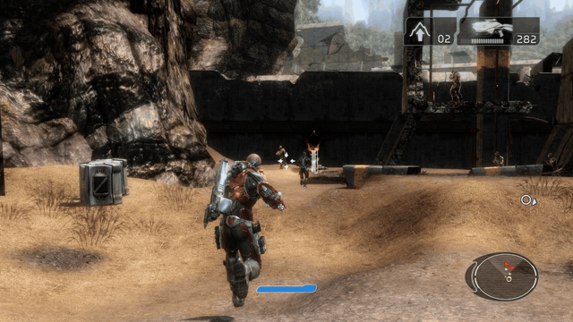

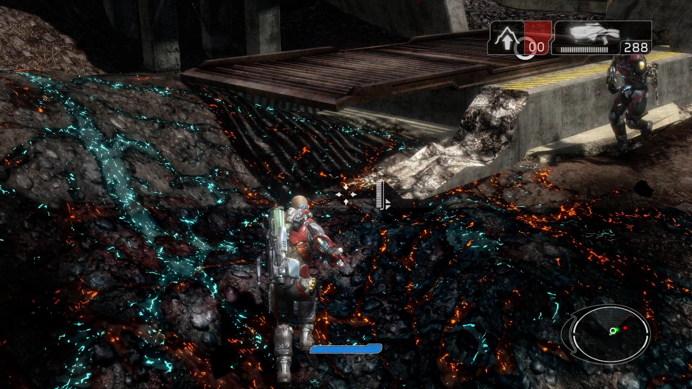
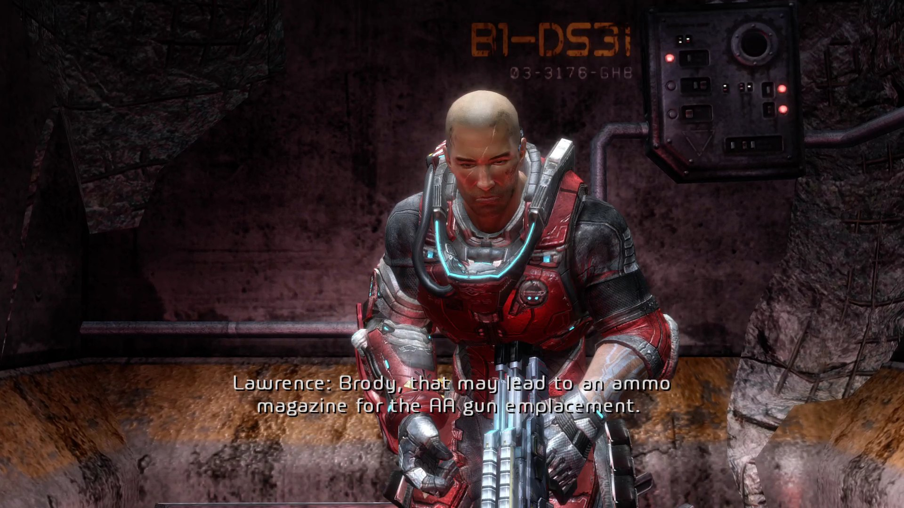
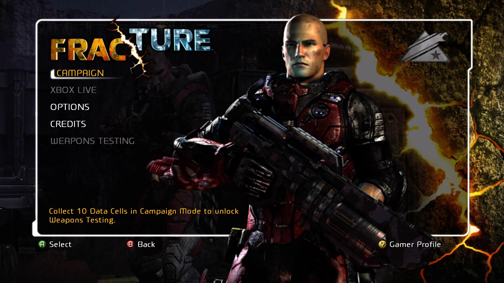
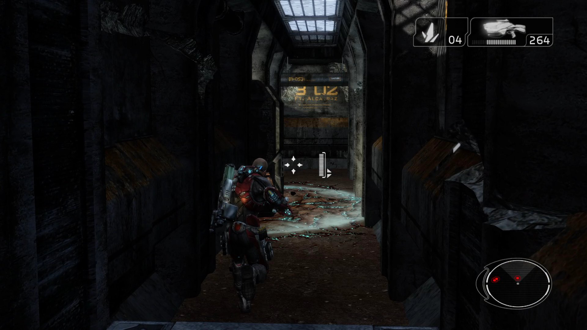

<sub>Recorded on Windows 11 with Internal Resolution 3x (2160p) and 60 FPS. <b>No game files included</b>: you need your own Xbox 360 disc image.</sub>

</div>

## At a glance

| | | |
| :-- | :-- | :-- |
| 💿 **Unzip and play**<br>The first start copies the game from your `.iso`; nothing else to install. | 🖥️ **Up to 4K and beyond**<br>Render at 1x to 4x the console's 720p. | 🎞️ **60 FPS**<br>Twice the original 30, switchable while you play. |
| ⚙️ **Settings in the game**<br><kbd>Esc</kbd>, <kbd>F1</kbd> or <kbd>RB</kbd> + <kbd>Start</kbd>, no config files to edit. | 🎮 **Controller, keyboard and mouse**<br>Xbox and PlayStation pads work out of the box. | 🔀 **Direct3D 12 or Vulkan**<br>Pick the graphics API and the GPU. |
| 🏆 **Achievements**<br>Pop up as on the console and stay unlocked. | 📀 **Two disc releases**<br>Two Xbox 360 releases of the game are supported. | 🕹️ **Steam Deck**<br>Runs well under Proton. |

> [!NOTE]
> **Early days.** Fracture is playable from the start (the footage on this page is from the first
> mission), but the whole campaign has not been played through yet. If the game stops with an error,
> please [report it](#reporting-a-problem).

## In motion

<div align="center">

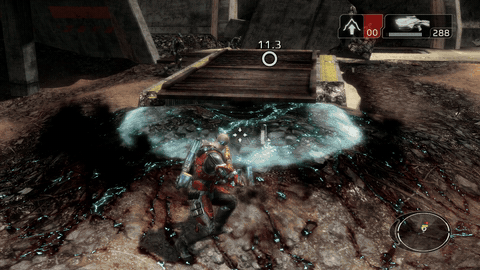
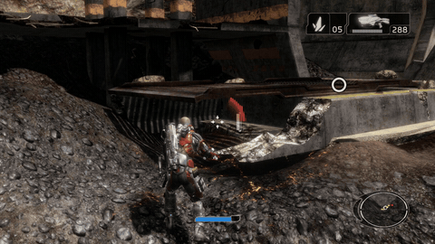

<sub><b>Raise and lower the ground</b> with the entrencher &nbsp;·&nbsp; <b>Grenades</b> that tear the terrain apart</sub>

<br>

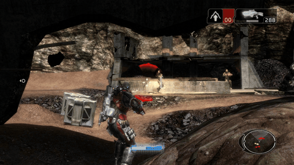
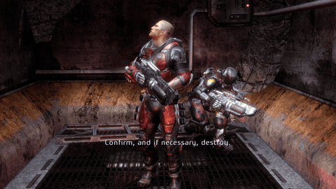

<sub><b>Firefights</b> in the bunker yard &nbsp;·&nbsp; <b>Cutscenes</b> rendered in 4K like the rest of the game</sub>

</div>

## 720p vs 4K

**Internal Resolution** draws the game at a multiple of the Xbox 360's 1280 × 720 picture and scales
it to your screen. The same spot at the start of the first mission, at 1x and at 3x:

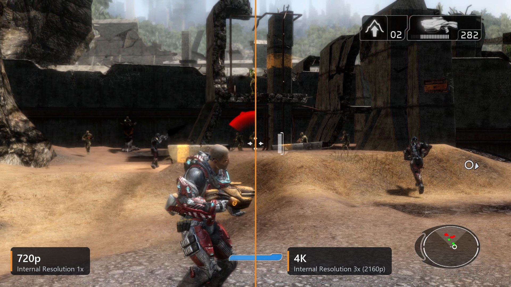

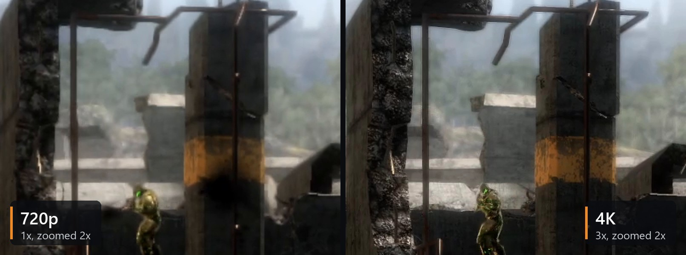

<sub>Both recorded at 1920 × 1080 with anti-aliasing off and 4x texture filtering. The close-up shows
the same part of each frame zoomed 2x: at 3x the rock, the rust and the pipes keep their detail
instead of turning to blur.</sub>

| Setting | The game renders at | |
| :-- | :-- | :-- |
| 1x (720p) | 1280 × 720 | Like the console |
| 2x (1440p) | 2560 × 1440 | Sharp on a 1080p or 1440p screen |
| 3x (2160p) | 3840 × 2160 | 4K; used for every shot on this page |
| 4x (2880p) | 5120 × 2880 | For the strongest graphics cards |

On the test PC (GeForce RTX 4080 SUPER) 3x runs at a steady 60 FPS.

## Getting started

**You need:** Windows 10 (version 1903 or later) or 11, 64-bit, or a
[Steam Deck](#steam-deck) · a graphics card with Direct3D 12 or Vulkan · about 4 GB of free space · a disc image (`.iso`) of your own Xbox 360 copy of Fracture.

1. Download `FractureRecomp-v…-windows-x64.zip` from
   **[Releases](https://github.com/ASarafanov/fracturerecomp/releases/latest)** and unpack it to a
   folder you can write to, for example `Documents\Games\FractureRecomp`. Not into `Program Files`:
   settings and logs are saved next to the game.
2. Start **`fracture.exe`**. The program is not code-signed, so Windows may say "Windows protected
   your PC": click **More info**, then **Run anyway**.
3. On the install screen choose your disc image with **Browse...** (or drop the `.iso` onto the
   window) and press **Install**. The image is only read, never changed. Copying takes a minute or
   two.
4. Press **Play**. From now on the game starts straight away and the `.iso` is no longer needed.

<div align="center">
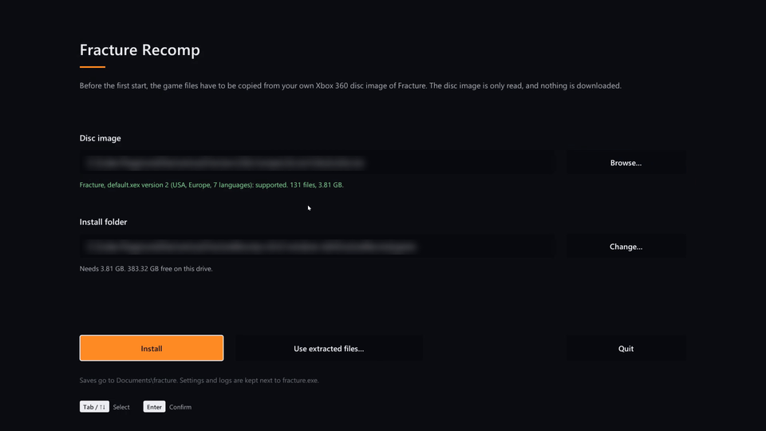
</div>

- Already have the game files extracted (a folder with `default.xex` and `resources`)? Press
  **Use extracted files...** or drop that folder onto the window.
- If the copy is interrupted (window closed, PC turned off), the next start continues where it
  stopped.
- The install screen works with the mouse, the keyboard (<kbd>Tab</kbd>, arrows, <kbd>Enter</kbd>)
  and a controller (D-pad, <kbd>A</kbd>).

### Which disc works

| | Release | Media ID |
| :-: | :-- | :-- |
| ✅ | Version 1 | `20E2A1F5` |
| ✅ | Version 2, USA / Europe, 7 languages | `43445F92` |

You don't need to know which one you have: the install screen checks the disc and says if it is
not supported. Other versions are refused, because the recompiled game is made from these two
exact releases.

<details>
<summary>SHA-256 of <code>default.xex</code> for each release</summary>

| Release | `default.xex` SHA-256 |
| --- | --- |
| Version 1 | `13fa6817089233d6d2b30adeca5c8bf74871ea28d0c620253aade6ee89557db2` |
| Version 2 | `6e1f8972281e02175617eb94bb9bde8baea1a1f767768dbfb0b4bed11b7bafee` |

</details>

### Updating

Unpack the new version over the old folder. Your game files, settings and saves stay.

### Steam Deck

**Tested: the game runs well on the Steam Deck under Proton.** Set it up in Desktop Mode:

1. Unpack the archive somewhere in your home folder, together with your `.iso` (or copy a folder
   that already has `game\` from your PC).
2. In Steam choose **Games > Add a Non-Steam Game to My Library** and add `fracture.exe`.
3. Open its **Properties > Compatibility**, turn on Proton and start the game. The first start
   opens the install screen, as on Windows.

Afterwards it starts from Game Mode like any other game in your library. With Graphics API on
**Automatic**, the game uses Vulkan under Proton. Other Linux PCs with Proton should work the same
way, but have not been tried yet.

## The settings screen

Press <kbd>Esc</kbd> or <kbd>F1</kbd> in the game, or <kbd>RB</kbd> + <kbd>Start</kbd> on a
controller (<kbd>R1</kbd> + <kbd>Options</kbd> on a DualSense). The screen works with the
keyboard, the mouse and a controller; the game gets no input while it is open.

<div align="center">
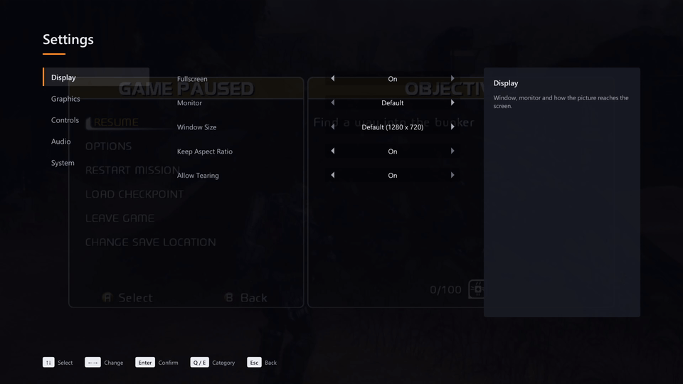
<sub>Switching to 4K and 60 FPS. Settings that need a restart turn yellow, and two presses of <kbd>X</kbd> restart the game on the spot.</sub>
</div>

<br>

<table>
<tr>
<td width="55%">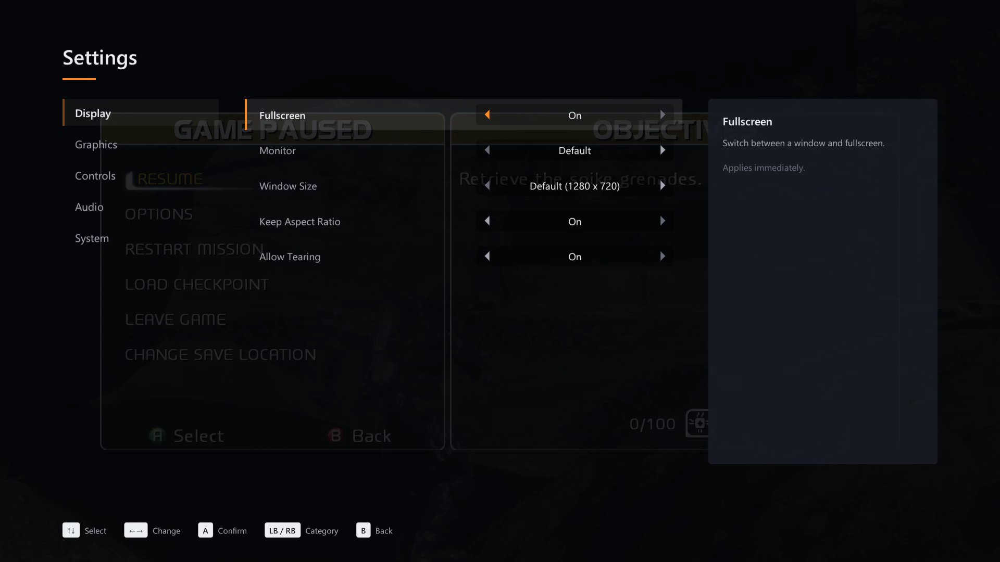</td>
<td valign="middle">

### Display
- **Fullscreen**, on or off
- **Monitor** the game opens on
- **Window Size**: 1280 × 720, 1600 × 900, 1920 × 1080 or 2560 × 1440
- **Keep Aspect Ratio**: black bars instead of a stretched picture
- **Allow Tearing**: lower latency, needed for G-Sync and FreeSync

</td>
</tr>
<tr>
<td valign="middle">

### Graphics
- **Frame Rate**: 30 (original) or 60
- **Graphics API**: Automatic, Direct3D 12 or Vulkan
- **Graphics Card**, for PCs with more than one
- **Internal Resolution**: 1x (720p) to 4x (2880p)
- **Anti-Aliasing**: off, FXAA or FXAA Extreme
- **Texture Filtering**: game default or 2x to 16x
- **Render Path**: Fast, or Accurate for rare blending errors (much slower)

</td>
<td width="55%">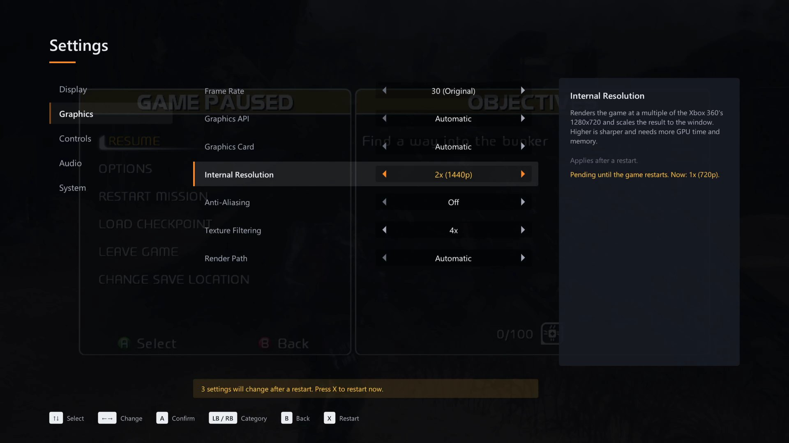</td>
</tr>
<tr>
<td width="55%">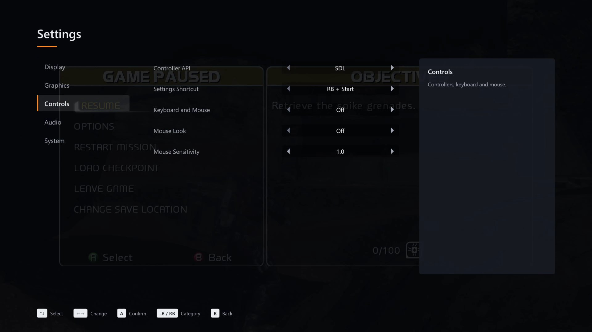</td>
<td valign="middle">

### Controls
- **Controller API**: SDL (Xbox, PlayStation and other pads) or XInput
- **Settings Shortcut**: RB + Start, LB + RB + Start, Back + Start, L3 + R3 or off
- **Keyboard and Mouse**: play with the keyboard as a controller
- **Mouse Look** and **Mouse Sensitivity**

</td>
</tr>
<tr>
<td valign="middle">

### Audio
- **Mute**
- **Audio Latency**: from Low to Most Stable; raise it if the sound crackles

</td>
<td width="55%">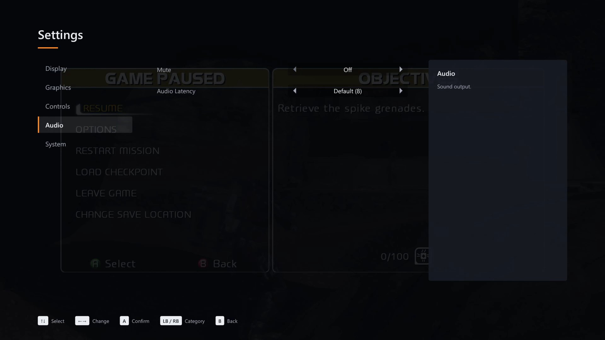</td>
</tr>
<tr>
<td width="55%">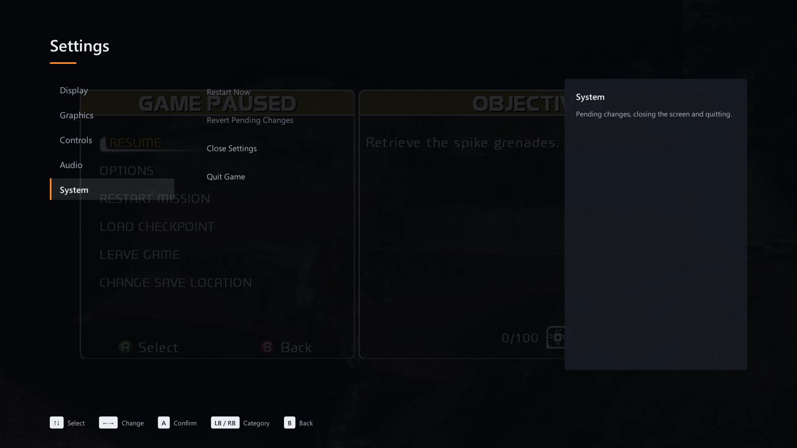</td>
<td valign="middle">

### System
- **Restart Now** to apply waiting changes
- **Revert Pending Changes**
- **Close Settings** and **Quit Game**

</td>
</tr>
</table>

| Keyboard | Controller | Action |
| :-- | :-- | :-- |
| <kbd>↑</kbd> <kbd>↓</kbd> | D-pad, left stick | Choose a setting |
| <kbd>←</kbd> <kbd>→</kbd> | D-pad, left stick | Change its value |
| <kbd>Enter</kbd> or <kbd>Space</kbd> | <kbd>A</kbd> | Confirm |
| <kbd>Q</kbd> / <kbd>E</kbd> | <kbd>LB</kbd> / <kbd>RB</kbd> | Previous / next category |
| <kbd>Esc</kbd> or <kbd>Backspace</kbd> | <kbd>B</kbd> | Back, then close |
| <kbd>R</kbd> twice | <kbd>X</kbd> twice | Restart now (when changes are waiting) |

With the mouse, point at a setting and click the arrows next to its value.

**How changes apply.** Some settings, such as Frame Rate and Fullscreen, take effect at once. The
others turn yellow and wait for a restart: press <kbd>R</kbd> (<kbd>X</kbd> on a controller) twice
or use **System > Restart Now**. The game
closes and starts again with the new settings, so save your progress first. Your choices are kept
in `settings.toml` next to `fracture.exe`; delete that file to go back to the defaults.

## More screenshots

<div align="center">

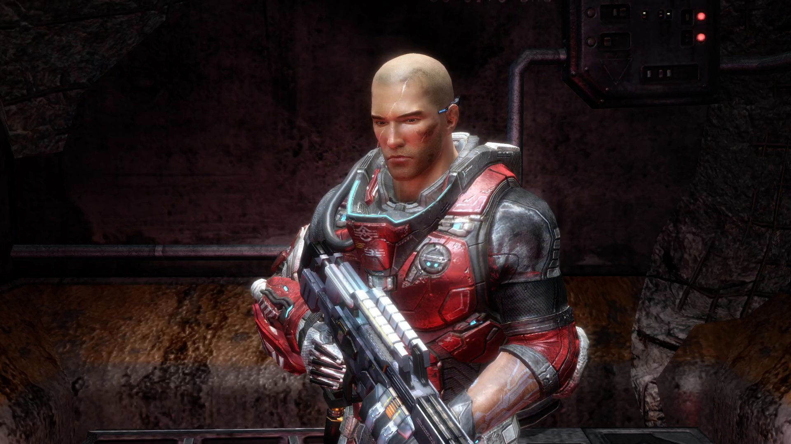
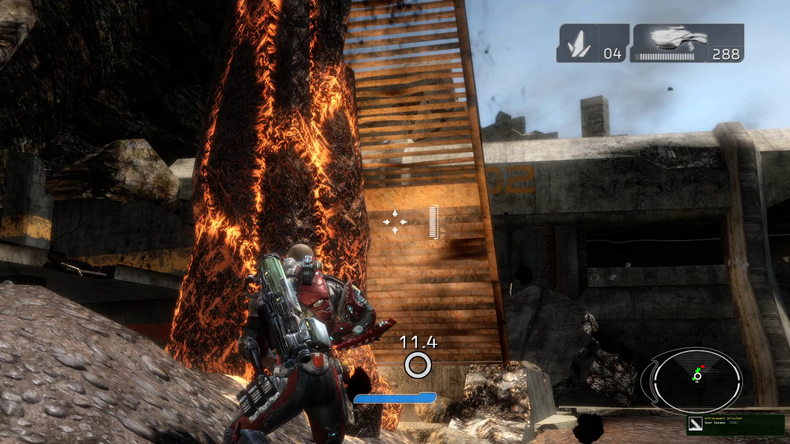

<sub><b>Cutscenes</b> &nbsp;·&nbsp; <b>Achievements</b> pop up in the corner, as on the console</sub>

<br>

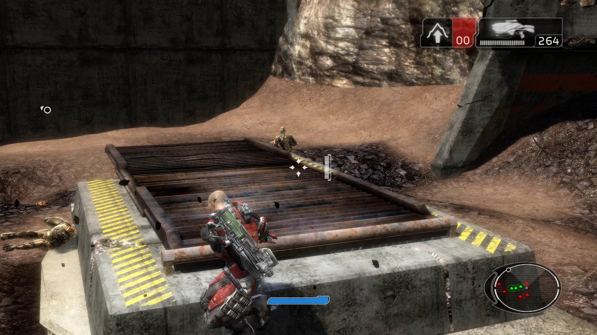
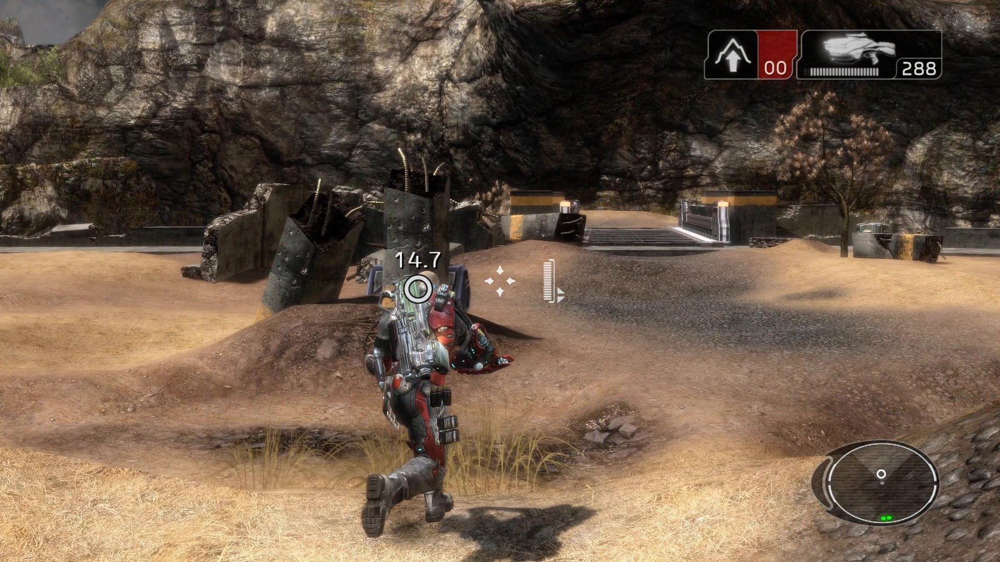
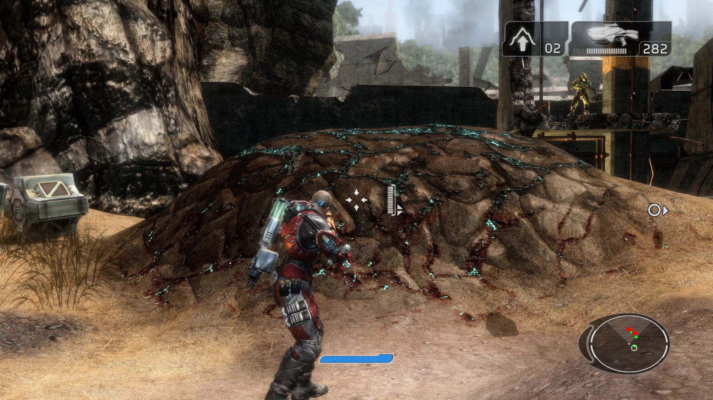
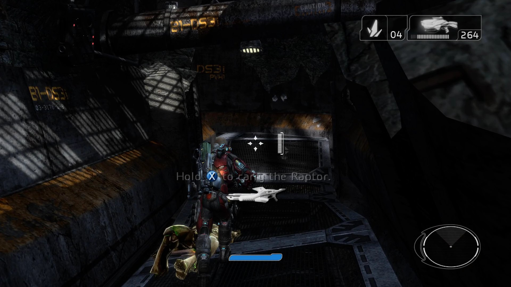

</div>

## Good to know

### Where things are

| What | Where |
| :-- | :-- |
| Game files | `game\` next to `fracture.exe`, or the folder you chose |
| Settings | `settings.toml` next to `fracture.exe` |
| Saves, achievements, shader cache | `Documents\fracture` |
| Log files | `logs\` next to `fracture.exe` |

### Known issues

- **60 FPS is experimental.** Fracture was made for 30. In testing the game kept its normal speed
  at 60, but some of its timers count frames. If anything moves too fast, set Frame Rate back to 30.
- **The game keeps running behind the settings screen.** Pause it first (<kbd>Start</kbd>) if you
  are in the middle of a fight.
- **Vulkan does not start?** Delete the `fracture_graphics_api` line from `settings.toml` to go
  back to Direct3D 12.
- **Antivirus warnings.** New, unsigned programs are sometimes flagged. If yours blocks
  `fracture.exe` or its DLLs, whether to allow them (Windows Security > Protection history) is your
  decision; the full source is here to check or build yourself.

### Reporting a problem

[Open an issue](https://github.com/ASarafanov/fracturerecomp/issues) and include what you were
doing, your Windows version and graphics card, which disc release you have, and the newest file
from the `logs\` folder.

## About the port

Fracture's PowerPC code was translated to C++ ahead of time with the
[ReXGlue SDK](https://github.com/rexglue/rexglue-sdk) and compiled into a regular Windows
program. The Xbox 360 graphics chip is emulated on Direct3D 12 or Vulkan.

This repository contains **no game files and no code generated from them**. The release downloads
contain the recompiled program (`fracture.exe`) but no game data: the program copies the game from
your own disc image on its first start.

<details>
<summary><b>Building from source (for developers)</b></summary>

You need Windows 10/11 x64, Python 3.9 or newer, Visual Studio 2022 Build Tools with the C++
workload, LLVM/Clang 20 or newer, Git, your Fracture `.iso` and about 8 GB of free space.

```powershell
winget install --id Microsoft.VisualStudio.2022.BuildTools --override "--passive --wait --add Microsoft.VisualStudio.Workload.VCTools --includeRecommended"
winget install --id LLVM.LLVM
winget install --id Git.Git
```

Then drag your `.iso` onto `setup.bat`, or run it from the repository folder:

```powershell
.\setup.bat path\to\Fracture.iso
```

Setup checks the disc, extracts the game into `game\`, builds the ReXGlue SDK 0.10.0 from source
with Direct3D 12 and Vulkan, recompiles the game and builds `fracture.exe` (about 10 minutes the
first time on a 16-thread CPU; running it again skips finished steps). Start the result with:

```powershell
& .\out\build\win-amd64-relwithdebinfo\fracture.exe
```

`python tools/package_release.py --version X.Y.Z` makes the release archive. It needs both
releases' `default.xex`, so run setup once with each disc first.

</details>

## Credits

- [ReXGlue SDK](https://github.com/rexglue/rexglue-sdk), the recompilation SDK this project is
  built on
- [Xenia](https://github.com/xenia-project/xenia), for Xbox 360 research
- [skate3recomp](https://github.com/mchughalex/skate3recomp), whose layout this project follows

> [!IMPORTANT]
> Fracture is a trademark of its respective owners. This project is not affiliated with or
> endorsed by them or by Microsoft.
