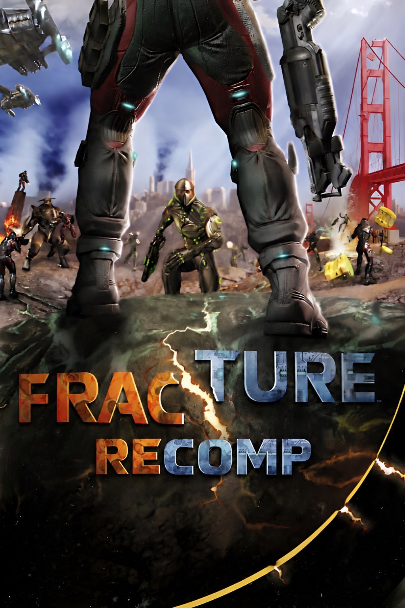

# FractureRecomp

<p align="center">
  
</p>

An unofficial native recompilation of the Xbox 360 version of **Fracture**
(Day 1 Studios / LucasArts, 2008) for Windows, built on the
[ReXGlue SDK](https://github.com/rexglue/rexglue-sdk).

The game's PowerPC code is translated to C++ ahead of time and compiled into a
regular Windows executable. Rendering goes through the SDK's emulated Xenos GPU
on Direct3D 12 or Vulkan.

> **Status: early.** The game boots and runs on the test machine (Windows 11,
> GeForce RTX 4080 SUPER). It has not been played through or tried on other
> hardware yet. See [Development](#development) for where this stands.

This repository contains **no game files and no code generated from them**.
The release downloads contain the recompiled program (`fracture.exe`) but no
game data: you need your own legally obtained Xbox 360 copy of Fracture, and
the program copies the game files from your disc image on its first start.

## Playing

### Requirements

- Windows 10 (version 1903 or later) or 11, x64, or a Steam Deck / Linux with
  Proton (not tested yet)
- A graphics card with Direct3D 12 or Vulkan
- A disc image (`.iso`) of the Xbox 360 release of Fracture (title ID
  `4C4107D4`). Two releases are supported; the recompiled code is made from
  their exact `default.xex`, so others are refused:

  | Release | Media ID | `default.xex` SHA-256 |
  | --- | --- | --- |
  | Version 1 | `20E2A1F5` | `13fa6817089233d6d2b30adeca5c8bf74871ea28d0c620253aade6ee89557db2` |
  | Version 2, USA / Europe, 7 languages | `43445F92` | `6e1f8972281e02175617eb94bb9bde8baea1a1f767768dbfb0b4bed11b7bafee` |
- About 4 GB of free disk space for the game files

Nothing else: no Visual Studio, no Python, no runtime installers. The archive
carries the Visual C++ runtime it needs.

### First start

1. Download `FractureRecomp-v<version>-windows-x64.zip` from
   [Releases](https://github.com/ASarafanov/fracturerecomp/releases) and
   unpack it somewhere you can write to, for example
   `Documents\Games\FractureRecomp`. Not into `Program Files`: settings and
   logs are written next to `fracture.exe`.
2. Start `fracture.exe`. The program is not code-signed, so Windows may show
   "Windows protected your PC": click **More info**, then **Run anyway**.
3. The install screen opens. Choose your disc image with **Browse...** (or
   drop the `.iso` onto the window) and, if you like, another install folder
   with **Change...** (default: `game` next to `fracture.exe`), then
   **Install**. The image is checked first and only read, never changed.
   Copying takes a minute or two.
4. Press **Play**. Later starts go straight to the game; the `.iso` is no
   longer needed.

Already have the game files extracted (a folder with `default.xex` and
`resources`)? Use **Use extracted files...** instead, or drop that folder onto
the window. If the copy is interrupted (the window closed, the PC off), the
next start offers to continue where it stopped.

The screen works with the mouse, the keyboard (Tab or arrows, Enter) and a
controller (D-pad, A).

### Files

| Where | What |
| --- | --- |
| `game\` (or the folder you chose) | The game files from your disc |
| `fracture_v1.dll`, `fracture_v2.dll` | The recompiled game, one per supported release; `fracture.exe` loads the one that matches your game files (after installing the other release it restarts once) |
| `settings.toml` next to `fracture.exe` | Your settings, and the install folder if it is not `game\` |
| `logs\` next to `fracture.exe` | Log files, useful for bug reports |
| `Documents\fracture` | Saves and the shader cache |

To update, unpack the new version over the old folder: the game files and
your settings stay.

### Steam Deck

Not tested yet. In Desktop Mode, unpack the archive (or copy a folder that
already has `game\`), add `fracture.exe` as a non-Steam game and turn on
Proton for it (Properties > Compatibility). The install screen's file chooser
works there too. Graphics API "Automatic" picks Vulkan under Proton.

### Antivirus

New, unsigned programs are sometimes flagged by antivirus heuristics. If yours
removes or blocks `fracture.exe` or its DLLs, whether to allow them (Windows
Security > Protection history) is your decision; the source is all here to
check or build yourself.

## Building from source

For development, or to make the program yourself instead of downloading it.

### Requirements

- Windows 10/11 x64
- Python 3.9 or newer
- Visual Studio 2022 Build Tools with the C++ workload (provides the MSVC
  libraries, the Windows SDK, CMake and Ninja)
- LLVM/Clang 20 or newer
- Git (setup downloads the ReXGlue SDK source with it)
- Your Fracture `.iso` (see above) and about 8 GB of free disk space, not
  counting the `.iso`

Install the build tools with:

```
winget install --id Microsoft.VisualStudio.2022.BuildTools --override "--passive --wait --add Microsoft.VisualStudio.Workload.VCTools --includeRecommended"
winget install --id LLVM.LLVM
winget install --id Git.Git
```

### Setup

Drag your `.iso` onto `setup.bat`, or run it from the repository folder (the
same command works in Command Prompt and PowerShell):

```
.\setup.bat path\to\Fracture.iso
```

Without an argument it uses the single `.iso` in the repository folder, or asks
you to pick one. The setup program:

1. checks that the image is the supported Fracture release;
2. extracts the game files into `game\` (about 4 GB);
3. downloads the ReXGlue SDK 0.10.0 source with Git (about 700 MB, checked
   against the release tag's commit) and builds the SDK with Direct3D 12 and
   Vulkan into `third_party\rexglue-sdk\`. The SDK's own Windows package has
   no Vulkan;
4. recompiles `default.xex` and builds `fracture.exe`;
5. writes `fracture.toml` next to `fracture.exe` so it finds `game\`.

Steps 3 and 4 take about 10 minutes on a 16-thread CPU the first time.

When started by double-click or from PowerShell, it waits for a key press at
the end. Running it again skips the steps that are already done. Pass
`--config release` or `--config debug` for another build type
(default: `relwithdebinfo`).

Then double-click `out\build\win-amd64-relwithdebinfo\fracture.exe`, or run
it from PowerShell (a quoted path needs `&` in front):

```
& .\out\build\win-amd64-relwithdebinfo\fracture.exe
```

Copying the whole repository folder, including `game\` and `out\`, to another
PC or a Steam Deck works too: the game finds `game\` again on its own, even
though `fracture.toml` still names the old location.

### Making a release

```
python tools/package_release.py --version 0.4.0
```

builds the `win-amd64-release` preset and packs
`out\release\FractureRecomp-v0.4.0-windows-x64.zip`: `fracture.exe`, the
game code of both releases (`fracture_v1.dll`, `fracture_v2.dll`), the SDK's
DLLs (checked against the SDK's own files), the Visual C++ runtime DLLs they
import, `README.txt` and the third-party licenses. It checks every shipped
binary's imports (each must be shipped or part of Windows) and packs only
that list: never `game\`, `xex\`, the `.iso`, generated code, PDBs or the
maintainer's `fracture.toml` / `settings.toml`. Codegen needs both releases'
`default.xex` (`xex\v1\` and `xex\v2\`: run setup once with each disc), so
this runs on the maintainer's machine, not in CI.

## Settings

In the game, press **Esc** or **F1**, or **RB + Start** on a controller
(R1 + Options on a DualSense), to open the settings screen. It works with the
keyboard, the mouse and a controller; the game gets no input while it is open.

| Category | Settings |
| --- | --- |
| Display | Fullscreen, monitor, window size, keep aspect ratio, allow tearing |
| Graphics | Frame rate (30, or 60 as an experiment), graphics API (Direct3D 12 or Vulkan), graphics card, internal resolution (1x to 4x), anti-aliasing (FXAA), texture filtering, render path (fast or accurate) |
| Controls | Controller API (SDL or XInput), the shortcut that opens the screen, keyboard and mouse, mouse look and sensitivity |
| Audio | Mute, audio latency |
| System | Restart now, revert pending changes, close the screen, quit |

| Keyboard | Controller | Action |
| --- | --- | --- |
| Arrows | D-pad, left stick | Select, change the value |
| Enter, Space | A | Confirm |
| Esc, Backspace | B | Back (rows, categories, closed) |
| Q / E | LB / RB | Previous / next category |
| R twice | X twice | Restart now (when changes are pending) |

Some settings apply at once. The others turn yellow and take effect after a
restart: press R (X on a controller) twice, or use System > Restart Now.

- Choices are saved to `settings.toml` next to `fracture.exe`. It is applied
  after `fracture.toml`, so its values win; delete a line to go back to the
  default.
- Command-line flags such as `--resolution_scale=2` win over both files. The
  screen marks those settings with `*`.
- Graphics API "Automatic" uses Vulkan under Proton or Wine (Steam Deck,
  Linux) and Direct3D 12 on Windows. Without a Vulkan driver or GPU the game
  starts with Direct3D 12. If Vulkan is chosen and the game then fails to
  start, delete the `fracture_graphics_api` line from `settings.toml`.
- The game was made for 30 FPS. At 60 it kept its normal speed in testing,
  but some of its timers count frames, so 60 stays marked experimental.
- The SDK's own overlays are still there: F3 toggles its debug overlay, the
  backtick key opens a log console, and F4 lists every cvar for advanced use.
  F4's "Save to config" writes `fracture.toml`.

## Credits

- [ReXGlue SDK](https://github.com/rexglue/rexglue-sdk), the recompilation SDK
  used by this project
- [Xenia](https://github.com/xenia-project/xenia), for Xbox 360 research
- [skate3recomp](https://github.com/mchughalex/skate3recomp), whose layout this
  project follows

Fracture is a trademark of its respective owners. This project is not
affiliated with or endorsed by them or by Microsoft.
